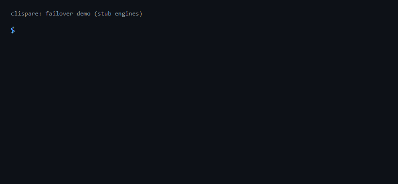

<div align="center">

# clispare: AI coding CLI failover for Claude Code, Codex, Gemini CLI and Grok

**One place to sign in to all your AI coding CLIs and API keys, with automatic failover between different engines.**
Hit a usage limit in Claude Code? `clispare run` moves the job to Codex, agy, Grok or an API key and remembers who is cooling down.

[](LICENSE)
[](https://www.npmjs.com/package/clispare)
[](https://github.com/ddivyanshsharmaa/clispare/stargazers)
[](https://github.com/ddivyanshsharmaa/clispare/commits)




<sub>The demo uses stub engines so a usage limit can be triggered on purpose. Real limit messages still need tuning: see [Known limits](#known-limits).</sub>

[Install](#install) · [Quick start](#quick-start) · [How failover works](#how-failover-works) · [Services](#supported-services) · [FAQ](#faq)

</div>

## Why

You probably use more than one AI coding tool: Claude Code, Codex, Gemini CLI or Antigravity, Grok, plus a few API keys. Each has its own login, its own limits and its own way of failing. When one hits a usage limit in the middle of a task, you stop and switch by hand.

clispare gives you two things:

1. **One account list.** Sign in to as many services and accounts as you like in one loop, with the email or ID of each, and see what is signed in with `clispare status`.
2. **A `run` command with failover.** `clispare run "your prompt"` tries one engine. If it hits a usage limit, a sign-in problem or a temporary error, the job moves to a *different* engine, and the limited one is skipped until it resets.

Zero dependencies, no daemon, no telemetry. It drives the real CLIs you already have installed.

## Install

Requires Node.js 18 or newer.

```bash
npm install -g clispare
clispare --help
```

Or run it without installing: `npx clispare status`.

## Quick start

```bash
clispare add        # asks which service to sign in to, over and over, until you type done
clispare status     # what is installed, signed in, and cooling down
clispare run "Refactor the billing webhook to use idempotency keys"
```

`clispare add` lists 15 services plus "another service (API key)". For each one it signs you in, asks for an optional email or ID so you can tell accounts apart, saves it, and asks again. Type `done` when you have finished.

| Command | What it does |
| --- | --- |
| `clispare add [service]` | Interactive sign-in loop |
| `clispare list [--json]` | Accounts, IDs, and the exact command to use each |
| `clispare status [--json]` | Installed? Signed in? Cooling down? |
| `clispare run [options] "prompt"` | Headless run with failover |
| `clispare use service[:name]` | Open the real CLI with that account |
| `clispare default service name` | Choose the account `run` uses for a service |
| `clispare remove service name` | Forget an account (deletes its key file) |
| `clispare reset [service[:name]]` | Clear cooldowns |
| `clispare doctor` | Check Node, binaries on PATH, stray credential variables |

`run` options: `--engines claude,codex,deepseek` (order), `--lane service:name` (pick an account), `--timeout SEC`, `--json`, `--verbose`. The prompt can also come from stdin.

Exit codes: `0` ok, `1` the task itself failed, `2` bad usage, `75` every lane is cooling down (the earliest reset is printed), `77` nothing is signed in.

## How failover works

Each attempt ends in exactly one outcome:

| Outcome | What clispare does |
| --- | --- |
| **ok** | Prints the answer and exits `0`. |
| **limit** (usage or rate limit, out of credit) | Puts that lane on cooldown (the reset time if the message gives one, otherwise 5 hours for CLI subscriptions, `Retry-After` or 60 s for HTTP 429, 24 h for HTTP 402) and tries the next engine. |
| **auth** (not signed in, bad key) | Cools that lane for 10 minutes and moves on. |
| **transient** (overloaded, 5xx, network) | Retries once after 2 s, then cools the lane for 5 minutes and moves on. |
| **fatal** (anything else) | Stops and returns that error. It never fails over on a task failure, because a bad prompt would burn every engine. |

Cooldowns are saved in `state.json`, so the next `clispare run` skips a limited engine straight away.

### Several accounts of one service

clispare supports several accounts per service (for example `claude:work` and `claude:personal`, each in its own folder), but **by default it does not rotate between accounts of the same provider to get past a usage limit**. `run` uses one account per service (the default one, or the one you pick with `--lane`), and fails over only to a different service. Choosing an account yourself, for example work versus personal, is always fine.

#### Optional: account rotation (off by default, at your own risk)

If you want `run` to move to the next account of the same service after a usage limit, turn it on yourself with `--rotate-accounts` (or `CLISPARE_ROTATE=1`):

```
clispare run --rotate-accounts "your prompt"
```

> **Warning.** Switching accounts to get past a usage limit may break that provider's terms of service. Providers can rate-limit, suspend or ban the accounts involved, and may link accounts that share a phone number, card or device. Only use accounts you can afford to lose, and check the provider's terms yourself. clispare prints this warning every time rotation is on. You are responsible for how you use it.

## Supported services

| Kind | Services | How sign-in works |
| --- | --- | --- |
| **Sign-in link** | Claude Code, Codex, Grok | The real tool prints a web address (`claude auth login`, `codex login`, `grok login`). Every account gets its own folder, and clispare checks that the sign-in worked before saving it. |
| **First run** | Antigravity (`agy`), Gemini CLI, Qwen Code, Kimi, GitHub Copilot CLI, Cursor Agent | You sign in the first time you run the tool. clispare only notes the account and says it did not verify it. |
| **API key** | DeepSeek, OpenRouter, Groq, Mistral, Z.ai, Together AI, and any other OpenAI-compatible service | You paste a key (nothing shows while you type). It is saved in a file only you can read and sent only to that provider. |

Engines `run` can use today: **Claude Code, Codex, Grok, agy** and every API-key service. The other first-run tools are listed so you can keep their accounts in one place, but `run` skips them for now.

## Privacy and safety

- Keys live in files with mode `0600` inside `~/.clispare` (override with `CLISPARE_HOME`). They are never printed, logged or written to `accounts.json` or `state.json`.
- The only network call is the one API request you ask for, to the provider you chose. No telemetry.
- When it starts a real CLI it removes `ANTHROPIC_API_KEY`, `ANTHROPIC_AUTH_TOKEN`, `CLAUDE_CODE_OAUTH_TOKEN`, `ANTHROPIC_BASE_URL`, `OPENAI_API_KEY` and `CODEX_API_KEY` from its environment, so a stray key cannot stand in for the account you chose. `clispare doctor` warns if any are set.
- On Windows, file permissions are best effort (NTFS does not use Unix modes), so keep your user folder private.

## Known limits

This is version 0.1. Please read these before relying on it:

- **Limit-message patterns are unverified.** clispare recognises a usage limit by matching text in each tool's error output. Those patterns have been tested with stub engines, not against real provider messages. If a real limit is not detected, open an issue with the output; the patterns live in one file, [`src/classify.js`](src/classify.js).
- **API endpoints and default models may go stale.** They are defaults in [`src/services.js`](src/services.js) and can be overridden with `CLISPARE_BASE_<SERVICE>` and `CLISPARE_MODEL_<SERVICE>`.
- **A new profile folder is empty.** An extra Claude Code or Codex account folder has none of your settings or skills.
- **macOS Keychain behaviour is untested.** Whether each Claude Code folder keeps its own login on macOS has not been verified. Tested so far on Windows only.
- clispare does not switch accounts inside a running interactive session.

## Alternatives

clispare is one of several tools in this space. Pick the one that fits:

- **[clauth](https://github.com/uwuclxdy/clauth)**: switches between many Claude Code accounts and shows live usage bars. Best if you only use Claude Code.
- **clispare** (this project): moves a job between *different* tools and API keys when one hits a limit. Best if you use several AI CLIs. Zero dependencies, Node 18+.

This project is independent and is not affiliated with or endorsed by Anthropic, OpenAI, Google, xAI or any other service it can call.

## FAQ

**How do I move a job from Claude Code to Codex when I hit the usage limit?**
Sign in to both with `clispare add`, then use `clispare run "your prompt"`. When Claude reports a limit, the job goes to the next engine.

**Can I keep several Claude Code accounts signed in at once?**
Yes. Each gets its own folder, selected with `CLAUDE_CONFIG_DIR`. `clispare list` prints the exact command for each. Switching between them is up to you.

**Does it work with DeepSeek, OpenRouter, Groq or Mistral?**
Yes, as API-key lanes: `clispare add`, choose the service, paste your key. Providers bill API use to your account.

**Is it a proxy or a gateway?**
No. It runs the real CLIs and plain API calls, one at a time, with no background server.

**Where is my data?**
In `~/.clispare` on your machine. Nothing is sent anywhere except the API call you ask for.

## Development

```bash
git clone https://github.com/ddivyanshsharmaa/clispare
cd clispare
npm test        # node --test, no network and no real CLIs needed
```

Tests use fake CLIs on `PATH` and a local HTTP server. Issues and pull requests are welcome, especially real usage-limit messages from the tools you use.

## License

[MIT](LICENSE)

---

If clispare saves you a stalled afternoon, a ⭐ helps other people find it.

---

Built by [Divyansh Sharma](https://www.divyanshsharma.me), an AI automation and web developer in Jaipur, India. More of my work: [GitHub](https://github.com/ddivyanshsharmaa) · [LinkedIn](https://www.linkedin.com/in/ddivyanshsharmaa/) · [Substack](https://divyanshsharmaa.substack.com) · [Website](https://www.divyanshsharma.me)
